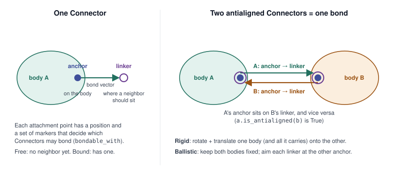

Connectors: Composable Chemical and Geometric Interfaces
========================================================

.. note::

   This page describes Connectors as reworked on the open refactor stack
   (`#123 <https://github.com/MuPT-hub/mupt/pull/123>`_,
   `#124 <https://github.com/MuPT-hub/mupt/pull/124>`_,
   `#152 <https://github.com/MuPT-hub/mupt/pull/152>`_,
   `#153 <https://github.com/MuPT-hub/mupt/pull/153>`_), not the
   ``0.1.3a1`` release. Names may still change before the stack is merged.

In MuPT a bond is not an edge stored between two Primitives. It is a pair
of **Connectors**, one on each side, that point at each other. A Connector
carries both the *chemistry* of one half of a bond (bond type, which
partners it may bond with) and its *geometry* (where the bond starts and
where the partner should sit). Building a system is largely a matter of
pairing Connectors up and moving bodies so that the pairs line up.

Anatomy of a Connector
----------------------

A Connector is made of two *attachment points*, each with a position and a
set of markers:

.. list-table::
   :header-rows: 1
   :widths: 20 80

   * - Part
     - Meaning
   * - ``anchor``
     - The on-body end: where the bond starts, on the Primitive that holds
       the Connector.
   * - ``linker``
     - The off-body end: where a bonded neighbor should sit.
   * - bond vector
     - From anchor to linker; its length is the bond length
       (``set_bond_length``).
   * - markers
     - Labels on each attachment point that decide which Connectors may be
       paired (``bondable_with``), so that, e.g., the "left" end of one
       repeat unit only bonds to the "right" end of the next.
   * - ``bondtype``
     - Single, double, aromatic, and so on.

A **connection** (a bond) is a pair of Connectors that are *antialigned*:
each Connector's anchor coincides with the other's linker, and vice versa.

         open linker off the body, joined by the bond vector. Right, two
         bodies whose Connectors are antialigned: each anchor sits on the
         other Connector's linker.
   :width: 100%

   A Connector (left) and a bond as two antialigned Connectors (right).

.. code-block:: python

   from mupt.interfaces.smiles import primitive_from_smiles

   # an ethylene repeat unit with two open ends, [*:1] and [*:2]
   unit = primitive_from_smiles(
       "[*:1]-[C:1](-[H])(-[H])-[C:2](-[H])(-[H])-[*:2]",
       label="mid",
       embed_positions=True,
   )
   left_end, right_end = unit.connections.connectors_free
   print(left_end.bondtype.name)              # SINGLE
   print(left_end.bondable_with(right_end))   # True: [*:1] can meet [*:2]

Antialignment: making the geometry agree
----------------------------------------

Pairing two Connectors fixes the topology, but the bodies they belong to
still have to be moved so the pair actually lines up. This is
*antialignment*, and MuPT keeps it out of the Connector class: each way of
doing it is a separate, interchangeable strategy.

.. list-table:: Antialignment strategies
   :header-rows: 1
   :widths: 25 75

   * - Strategy
     - What moves
   * - ``ConnectorAntialignmentRigid``
     - Computes the rotation and translation that bring one Connector (and
       everything attached to it) onto the other. Bond geometry inside the
       moved body is preserved.
   * - ``ConnectorAntialignmentBallistic``
     - "Point and shoot": keeps both bodies and both anchors fixed, aims each
       linker at the other anchor and stretches or shrinks the bond until
       they meet.

A full antialignment needs *both* Connectors to agree, which is why the
strategies offer ``antialign_mutually`` in addition to one-sided
transformations.

.. code-block:: python

   from mupt.mupr.connection.alignment import ConnectorAntialignmentRigid

   a, b = unit.copy(), unit.copy()
   a_right = next(c for c in a.connections.connectors_free if 2 in c.anchor.markers)
   b_left = next(c for c in b.connections.connectors_free if 1 in c.anchor.markers)
   a_right.set_bond_length(1.54)
   b_left.set_bond_length(1.54)

   align = ConnectorAntialignmentRigid()
   b.rigidly_transform(
       align.antialignment_transformation(align_connector=b_left, to_connector=a_right)
   )
   a.connect_neighbor(b, our_connector=a_right, their_connector=b_left)

   print(a_right.is_antialigned(b_left))   # True
   print(a.is_neighbors_with(b))           # True

*Adapted from* `#123 <https://github.com/MuPT-hub/mupt/pull/123>`_.

Neighbors, holders, and free vs. bound
--------------------------------------

Connectors refer to their partner directly: ``connector.neighbor``. Whether
two Primitives are bonded is decided by this Connector neighborship, not by
any list stored on the Primitives. Around that, a few pieces of
bookkeeping:

- **Free vs. bound.** A Connector with no neighbor is *free*; one with a
  neighbor is *bound*. This replaces the earlier "internal vs. external"
  distinction, which only made sense once a resolution had been chosen.
  The number of free Connectors is a Primitive's ``functionality``, and
  free Connectors are the candidates for new bonds.
- **Locks.** A Connector's neighbor can be locked to protect it from being
  changed; locking one side of a pair locks both.
- **Holders.** Each Connector knows which Primitive holds it, for reverse
  lookup.
- **Managers.** Collections of Connectors are handled by a
  ``ConnectorManager`` (``prim.connections``) rather than by the Primitive
  itself. A mutable manager is used while building; a frozen one can cache
  connection data once a topology is final.

.. code-block:: python

   print(unit.functionality)                  # 2: both ends are still free
   print(a.functionality, b.functionality)    # 1 1: one end of each is now bound

*Adapted from* `#124 <https://github.com/MuPT-hub/mupt/pull/124>`_.

Neighbors at any resolution
---------------------------

Only ``SimplePrimitive`` (and so ``AtomicPrimitive``) instances hold
Connectors directly. Every other Primitive *propagates* the Connectors of
its descendants upward, as the exact same objects rather than copies, so
every Primitive along a branch refers to identical Connector instances:

.. code-block:: text

       ...                      ...
        |                        |
   Parent1                     Parent2
        |                        |
   Simple1                    Simple2
           \                 /
             Conn1 --- Conn2

Because of this, any Primitive on one branch is potentially the neighbor of
any Primitive on the other branch, and there is nothing to keep in sync.
Which Primitive on the other branch counts as "the" neighbor is chosen with a
predicate (see :doc:`molecular_representation`): MuPT walks down the
neighbor's branch, from just below the ancestors the two Primitives share
toward the Primitive that holds the partner Connector, and picks the first
one that satisfies the predicate.

.. code-block:: python

   from mupt.mupr.primitives import CompositePrimitive
   from mupt.mupr.primitives.predicates import is_atom

   dimer = CompositePrimitive(label="dimer", children=[a, b])
   print(len(dimer.connections.connectors_free))   # 2: the two outer ends

   # the same bond, read at two resolutions
   print([prim is b for prim in a.neighbors(lambda prim: prim.label == "mid")])  # [True]
   print([atom.element.symbol for atom in a.neighbors(is_atom)])               # ['C']

*Adapted from* `#124 <https://github.com/MuPT-hub/mupt/pull/124>`_ *and*
`#152 <https://github.com/MuPT-hub/mupt/pull/152>`_.

Linking: from a graph to Connector pairs
----------------------------------------

Pairing Connectors by hand is fine for two repeat units and hopeless for a
polymer melt. Most software, and most chemists, already describe
connectivity as a graph. MuPT's **linker** takes a graph whose nodes are
Primitives and, using the Connectors' markers, decides which pair of
Connectors to use for each edge. Building a system then reduces to
generating a graph, for which plenty of tools exist, even for complex
topologies such as sheets or dendrimers.

The usual entry point is ``populate_from_topology_and_lexicon``: give it a
labelled graph and a *lexicon* mapping each label to a template Primitive,
and it copies the templates, attaches them as children, and links them:

.. code-block:: python

   from mupt.graphs.generators import path_graph_from_sequence

   lexicon = {
       "head": primitive_from_smiles(
           "[H:1]-[C:1](-[H])(-[H])-[C:2](-[H])(-[H])-[*:2]", label="head"
       ),
       "mid": primitive_from_smiles(
           "[*:1]-[C:1](-[H])(-[H])-[C:2](-[H])(-[H])-[*:2]", label="mid"
       ),
       "tail": primitive_from_smiles(
           "[*:1]-[C:1](-[H])(-[H])-[C:2](-[H])(-[H])-[H:2]", label="tail"
       ),
   }
   chain = CompositePrimitive(label="PE", role="segment")
   chain.populate_from_topology_and_lexicon(
       path_graph_from_sequence(["head", "mid", "mid", "tail"]), lexicon
   )
   print(chain.functionality)   # 0: every end has been paired

``connect_neighbor`` uses the same linker when you do not name the
Connectors yourself.

.. note::

   Two current limits, both tracked on the stack: the linker does not yet
   handle multigraphs (several bonds between the same two Primitives, as
   in ladder polymers or cyclophanes), and linking templates that already
   have coordinates does not yet align them. See
   :doc:`topology_to_coordinates` for the workaround used today.

*Adapted from* `#153 <https://github.com/MuPT-hub/mupt/pull/153>`_ *and*
`#154 <https://github.com/MuPT-hub/mupt/pull/154>`_.

Open questions recorded on the stack
------------------------------------

These are design points still under discussion; they are listed here so
readers know they may change:

- Renaming one-sided ``antialign_*`` methods (e.g. ``antialign_unilaterally_*``)
  to make clear that a full antialignment needs ``antialign_mutually``
  (`#123 <https://github.com/MuPT-hub/mupt/pull/123>`_).
- A sign flip at a dihedral angle of exactly 0 during antialignment
  (`#123 <https://github.com/MuPT-hub/mupt/pull/123>`_).
- Whether ``BondType.UNSPECIFIED`` should relax the bond-order match
  required of neighbor Connectors
  (`#124 <https://github.com/MuPT-hub/mupt/pull/124>`_).
