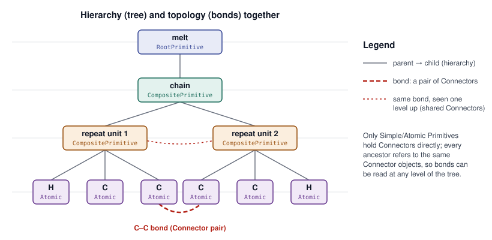

MuPT's Molecular Representation: Hierarchy and Topology
========================================================

.. note::

   This page describes the refactored representation on the open
   refactor stack (`#141 <https://github.com/MuPT-hub/mupt/pull/141>`_
   through `#159 <https://github.com/MuPT-hub/mupt/pull/159>`_), not the
   ``0.1.3a1`` release. Names and module paths may still change before the
   stack is merged.

A MuPT representation stores two kinds of information about a molecular
system at once:

- **Hierarchy**: which parts belong to which. A melt is made of chains, a
  chain of repeat units, a repeat unit of atoms. This is a tree.
- **Topology**: which parts are bonded to which. This is a graph, and it
  can be read at any level of the tree: atoms are bonded to atoms, and
  therefore repeat units are bonded to repeat units.

Every node of the tree is a *Primitive*. Bonds are not stored as edges
between Primitives; they are pairs of *Connectors* (see :doc:`connectors`).
Only the lowest Primitives hold Connectors directly, and every ancestor
refers to the very same Connector objects, which is what lets the bond
graph be read at any resolution.

         two CompositePrimitive repeat units, each holding AtomicPrimitive
         atoms. A dashed red C–C bond joins a carbon in each repeat unit,
         and a lighter dashed line shows the same bond seen between the
         repeat units one level up.
   :width: 100%

   One tree, one set of bonds. The bond between the two carbons is a pair
   of Connectors held by the atoms; because the repeat units refer to the
   same Connectors, they are bonded neighbors too.

Kinds of Primitive
------------------

``Primitive`` itself is a base class that is never instantiated. It defines
what every part of a representation has (a label, a role, a shape, a mass,
metadata, access to Connectors, copying and rigid transformation) and
leaves hierarchy and connectivity to its subtypes. Two *structural*
subtypes say where a Primitive may sit in a tree, and four *concrete*
subtypes are the ones you create:

.. list-table:: Concrete Primitive types
   :header-rows: 1
   :widths: 22 13 13 52

   * - Type
     - Parent?
     - Children?
     - Role in a hierarchy
   * - ``RootPrimitive``
     - never
     - yes
     - Top of a hierarchy. Holds system-wide information (e.g. box
       vectors) and global settings such as mutability. The entry point
       for exporters.
   * - ``CompositePrimitive``
     - yes
     - yes
     - The "connective tissue" between the root and the leaves: chains,
       repeat units, blocks, beads made of atoms, and so on.
   * - ``SimplePrimitive``
     - yes
     - no
     - An irreducible part of the system *from the point of view of the
       representation*. The only kind of Primitive that holds Connectors
       directly rather than by reference.
   * - ``AtomicPrimitive``
     - yes
     - no
     - A ``SimplePrimitive`` that stores an element from the periodic
       table: an atom.

The inheritance tree, where ``NodeMixin`` comes from the
`anytree <https://anytree.readthedocs.io/en/latest/api/anytree.node.html>`_
library and supplies most of the generic tree operations:

.. code-block:: text

               NodeMixin
                   |
               Primitive
                /      \
   SupportsChildren  SupportsParents
        /       \       /      \
     Root      Composite      Simple
                                 \
                                Atom

A small example, built from SMILES:

.. code-block:: python

   from mupt.interfaces.smiles import primitive_from_smiles
   from mupt.mupr.primitives import AtomicPrimitive, CompositePrimitive

   ethanol = primitive_from_smiles("CCO", label="ethanol")
   assert isinstance(ethanol, CompositePrimitive)
   assert all(isinstance(atom, AtomicPrimitive) for atom in ethanol.children)
   print(ethanol.hierarchy_summary())

.. code-block:: text

   ethanol
   ├── C-0
   ├── C-1
   ├── O-2
   ├── H-3
   ...

*Adapted from* `#142 <https://github.com/MuPT-hub/mupt/pull/142>`_ *and*
`#144 <https://github.com/MuPT-hub/mupt/pull/144>`_.

Assembling a hierarchy, then freezing it
----------------------------------------

Building a system and using a system have different needs. Assembly (by
hand or by a recipe) constantly changes which Primitive is the parent or
child of which. Walking over a finished system, exporting it, or reasoning
about it is much simpler when that information cannot change underneath
you. MuPT supports both: hierarchies are mutable while you build them, and
can then be *frozen*.

- Freezing applies to the **whole hierarchy**, no matter which Primitive
  you call it on, so no part of a tree can be edited while another part
  assumes it is fixed.
- Freezing is **reversible**, so you can edit an existing system later,
  and tools that interface with MuPT can apply changes from their own
  calculations.

.. code-block:: python

   from mupt.mupr.primitives import RootPrimitive

   chain = CompositePrimitive(label="chain", role="segment")
   system = RootPrimitive(label="system", role="universe", children=[chain])

   system.freeze_hierarchy()
   try:
       chain.attach_child(primitive_from_smiles("C", label="methane"))
   except AttributeError as error:
       print(error)  # Hierarchy of this Primitive is read-only accessible; ...

   system.unfreeze_hierarchy()
   chain.attach_child(primitive_from_smiles("C", label="methane"))  # fine again

*Adapted from* `#148 <https://github.com/MuPT-hub/mupt/pull/148>`_.

Choosing a working level: predicates
------------------------------------

Many tasks only care about one "level" of a system: the atoms for an
all-atom force field, the repeat units for a coarse-grained model, the
chains for a per-molecule analysis. MuPT does not hard-code what a level
is. Instead, a level is selected with a **predicate**: a function that
takes a Primitive and returns ``True`` or ``False``. This works
independently of the shape of the tree, including trees that cannot be
cut into neat parallel layers.

Any callable works, including a ``lambda``. To cover the common cases,
``mupt.mupr.primitives.predicates`` provides ready-made predicates:

.. list-table:: Ready-made predicates
   :header-rows: 1
   :widths: 30 70

   * - Kind
     - Examples
   * - Intrinsic properties
     - ``is_simple``, ``supports_children``, ``supports_parents``
   * - Hierarchy properties
     - ``has_depth_factory(depth)``, ``is_flat``, ``is_laminar``,
       ``is_complete``
   * - Atom-specific properties
     - ``is_atom``, ``is_superatomic``, ``is_atomizable``
   * - Roles
     - any test on ``prim.role``, e.g. ``lambda prim: prim.role == "residue"``
       (see :doc:`roles_depth_and_saamr`)

.. code-block:: python

   from mupt.mupr.primitives.predicates import is_atom, is_laminar

   is_residue = lambda prim: prim.role == "residue"

   print(is_atom(next(iter(ethanol.children))))  # True
   print(is_laminar(system))                     # True

Predicates are what :doc:`cross-sections <topology_to_coordinates>` and
neighbor searches (:doc:`connectors`) use to decide which level of the tree
they work at.

Composite Primitives also report their **mass** as the sum of their
children's masses. Atoms take their mass from their element. If any
Primitive in a subtree has no mass, asking for the cumulative mass raises
``TypeError`` rather than silently returning a partial sum.

*Adapted from* `#151 <https://github.com/MuPT-hub/mupt/pull/151>`_.

Where this fits
---------------

- :doc:`connectors` explains how bonds are stored and made.
- :doc:`roles_depth_and_saamr` explains how a tree of any shape is presented
  to tools that expect fixed levels (MDAnalysis, PDB, RDKit).
- :doc:`topology_to_coordinates` explains how to slice a hierarchy into a
  graph, give it coordinates, and hand it to other tools.

The refactor that introduced this design is organized as a stack of pull
requests starting at `#141 <https://github.com/MuPT-hub/mupt/pull/141>`_,
which moved the previous ``Primitive`` implementation to
``mupt.mupr.primitives.primitives_legacy``.
