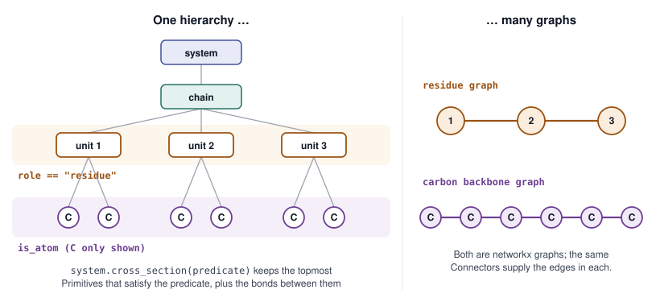
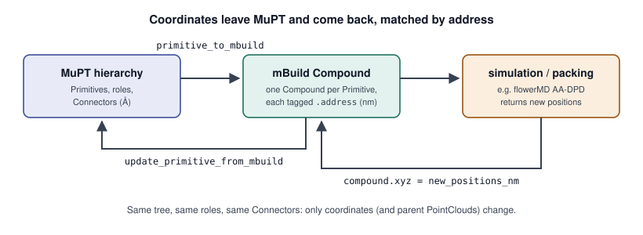

From Molecular Topology to Three-Dimensional Coordinates
========================================================

.. note::

   This page describes the open refactor stack
   (`#153 <https://github.com/MuPT-hub/mupt/pull/153>`_ through
   `#159 <https://github.com/MuPT-hub/mupt/pull/159>`_, plus
   `#166 <https://github.com/MuPT-hub/mupt/pull/166>`_), not the
   ``0.1.3a1`` release. Names may still change before the stack is merged.

A MuPT representation holds a system at many resolutions at once (see
:doc:`molecular_representation`). Simulation engines, force fields and file
formats each want *one* resolution: an atom graph with coordinates, or a
bead graph, or a list of chains. This page explains how MuPT gets from one
to the other: slicing the hierarchy into a graph at a chosen level,
attaching coordinates, and handing the result to other tools and back.

Cross-sections: one hierarchy, many graphs
------------------------------------------

Deciding which parts interact through bonds is central both to thinking
about a system and to applying a force field, and in MuPT it has to work at
whatever resolution you choose. The device for this is the
**cross-section**: the set of Primitives below a chosen Primitive that
satisfy a predicate, together with the bonds between them.

- Only the *topmost* matching Primitive on each branch is kept, so the
  slice never contains both a Primitive and one of its ancestors.
- Edges come from the shared Connectors (see :doc:`connectors`), and carry
  the bond order.
- The result is a ``networkx.Graph``, upgraded to a ``MultiGraph`` the
  first time two selected Primitives turn out to share more than one bond.

A PDB-like "chains / residues / atoms" view is just three particular
predicates. Any slice you can describe with a one-rule predicate works the
same way, and keeps its connectivity and spatial information.

         repeat units (role equals residue) and a band around the carbon
         atoms (is_atom). Right, the resulting graphs: a path of three
         repeat units, and a path of six carbons.
   :width: 100%

   Two predicates, two graphs, one set of Connectors.

.. code-block:: python

   from mupt.graphs.generators import path_graph_from_sequence
   from mupt.interfaces.smiles import primitive_from_smiles
   from mupt.mupr.primitives import CompositePrimitive, RootPrimitive
   from mupt.mupr.primitives.predicates import is_atom

   lexicon = {
       "head": primitive_from_smiles(
           "[H:1]-[C:1](-[H])(-[H])-[C:2](-[H])(-[H])-[*:2]", label="head"
       ),
       "mid": primitive_from_smiles(
           "[*:1]-[C:1](-[H])(-[H])-[C:2](-[H])(-[H])-[*:2]", label="mid"
       ),
       "tail": primitive_from_smiles(
           "[*:1]-[C:1](-[H])(-[H])-[C:2](-[H])(-[H])-[H:2]", label="tail"
       ),
   }
   chain = CompositePrimitive(label="PE", role="segment")
   chain.populate_from_topology_and_lexicon(
       path_graph_from_sequence(["head", "mid", "tail"]), lexicon
   )
   for unit in chain.children:
       unit.role = "residue"
   system = RootPrimitive(label="system", role="universe", children=[chain])

   residues = system.cross_section(lambda prim: prim.role == "residue")
   atoms = system.cross_section(is_atom)
   print(residues.number_of_nodes(), residues.number_of_edges())  # 3 2
   print(atoms.number_of_nodes(), atoms.number_of_edges())        # 20 19

The same machinery runs in the other direction. ``populate_from_topology_and_lexicon``
(used above, and described in :doc:`connectors`) *inserts* a pre-built
connectivity graph into a hierarchy, and ``connect_neighbor`` uses the
linker to choose Connectors when you do not name them.

*Adapted from* `#154 <https://github.com/MuPT-hub/mupt/pull/154>`_.

Giving a hierarchy coordinates
------------------------------

Every Primitive may carry a ``shape``: a point cloud for an atom or a group
of atoms, or a sphere, ellipsoid or rod for a coarse-grained body. MuPT
coordinates are in Ångström. Moving a Primitive with ``rigidly_transform``
moves its shape, the shapes of everything below it, and its Connectors
together.

The intended route to coordinates is to give the template Primitives
coordinates (e.g. ``primitive_from_smiles(..., embed_positions=True)``)
and let linking place each copy against its neighbor by antialigning the
Connectors. On the current stack, linking templates that already have
coordinates does not yet align them; this is the main open item on the
stack (`discussion on #159
<https://github.com/MuPT-hub/mupt/pull/159#issuecomment-6804125585>`_).
Until it is fixed, the same result comes from a short "place, then link"
loop: move each unit onto its neighbor's free Connector with a rigid
antialignment, then connect the pair.

.. code-block:: python

   from mupt.mupr.connection.alignment import ConnectorAntialignmentRigid

   repeat_unit_smiles = {
       "head": "[H:1]-[C:1](-[H])(-[H])-[C:2](-[H])(-[H])-[*:2]",
       "mid": "[*:1]-[C:1](-[H])(-[H])-[C:2](-[H])(-[H])-[*:2]",
       "tail": "[*:1]-[C:1](-[H])(-[H])-[C:2](-[H])(-[H])-[H:2]",
   }
   embedded = {  # templates with 3D coordinates
       name: primitive_from_smiles(smiles, label=name, embed_positions=True)
       for name, smiles in repeat_unit_smiles.items()
   }

   def build_chain(sequence, bond_length=1.54):
       """Place each embedded repeat unit on its neighbor's Connector, then link."""
       chain = CompositePrimitive(label="PE", role="segment")
       units = [embedded[name].copy() for name in sequence]
       for unit in units:
           unit.role = "residue"
           chain.attach_child(unit)
       align = ConnectorAntialignmentRigid()
       for a, b in zip(units, units[1:]):
           x, y = next(
               (x, y)
               for x in a.connections.connectors_free
               for y in b.connections.connectors_free
               if x.bondable_with(y)
           )
           x.set_bond_length(bond_length)
           y.set_bond_length(bond_length)
           b.rigidly_transform(
               align.antialignment_transformation(align_connector=y, to_connector=x)
           )
           a.connect_neighbor(b, our_connector=x, their_connector=y)
       return chain

   melt = RootPrimitive(
       label="melt", role="universe",
       children=[build_chain(["head"] + 8 * ["mid"] + ["tail"]) for _ in range(2)],
   )

Packing many chains into a dense, physically sensible box is a job for a
dedicated tool; the next section shows how MuPT hands the system to one and
takes the coordinates back.

Handing off to other tools, and back
------------------------------------

Interfaces live in ``mupt.interfaces``. Each one exports a *cross-section*
of the hierarchy, so the same system can go out as atoms or as beads.

.. list-table:: Interfaces on the refactor stack
   :header-rows: 1
   :widths: 24 38 38

   * - Tool
     - What exists
     - Pull request
   * - SMILES / RDKit
     - ``primitive_from_smiles``; RDKit importer ported, exporter in
       progress
     - `#157 <https://github.com/MuPT-hub/mupt/pull/157>`_
   * - mBuild / GMSO
     - ``primitive_to_mbuild`` (any cross-section, optionally keeping the
       intermediate levels); GMSO export in progress
     - `#158 <https://github.com/MuPT-hub/mupt/pull/158>`_
   * - mBuild → MuPT
     - ``update_primitive_from_mbuild``: read coordinates back onto an
       existing hierarchy
     - `#166 <https://github.com/MuPT-hub/mupt/pull/166>`_
   * - MDAnalysis
     - ``primitive_to_mdanalysis`` (all-atom and coarse-grained, using
       roles for segments and residues)
     - `#159 <https://github.com/MuPT-hub/mupt/pull/159>`_

mBuild matters in particular because flowerMD builds on it, and flowerMD
is how MuPT gets dense starting coordinates (e.g. all-atom DPD
initialization). The export tags every mBuild Compound with the
``address`` of the Primitive it came from. After the coordinates have been
changed elsewhere, ``update_primitive_from_mbuild`` uses those addresses to
put them back: each matched Primitive is translated onto its new position
(carrying its Connectors and anything below it), and the point clouds of
its ancestors are rebuilt. The hierarchy, roles and Connectors are
untouched, so the system can go straight on to the next tool.

         mBuild Compound tagged with addresses, sent to a simulation such as
         flowerMD, new positions set on the same Compound, and written back
         with update_primitive_from_mbuild.
   :width: 100%

   Coordinates leave MuPT and come back, matched by address.

.. code-block:: python

   import numpy as np
   from mupt.interfaces.mdanalysis import primitive_to_mdanalysis
   from mupt.interfaces.mosdef.mbuild import (
       primitive_to_mbuild,
       update_primitive_from_mbuild,
   )

   compound = primitive_to_mbuild(
       melt,
       predicate=is_atom,
       preserve_intermediates=True,  # keep chain and residue levels in mBuild
       coords_to_nm=0.1,             # MuPT is in Angstrom, mBuild in nm
   )

   # ... relax or simulate the Compound elsewhere; here, just shift it ...
   compound.translate([1.0, 0.0, 0.0])  # nm

   update_primitive_from_mbuild(melt, compound, coords_to_nm=0.1)

   universe = primitive_to_mdanalysis(melt, {"head": "PEH", "mid": "PEM", "tail": "PET"})
   print(universe.atoms.n_atoms, universe.residues.n_residues, universe.segments.n_segments)
   # universe.atoms.write("melt.pdb")

Coordinates from periodic simulations must be unwrapped before they are
read back, and ``coords_to_nm`` should be the same value in both calls.
mBuild particles carry positions only, so matched Primitives are
translated but never rotated.

*Adapted from* `#158 <https://github.com/MuPT-hub/mupt/pull/158>`_,
`#159 <https://github.com/MuPT-hub/mupt/pull/159>`_ *and*
`#166 <https://github.com/MuPT-hub/mupt/pull/166>`_.

Changing resolution (planned)
-----------------------------

Working at a coarser or finer level often means changing the tree itself:
removing a level, adding one, or replacing a whole subtree with a single
body. Exporting to a flat format strips everything between the root and
the leaves while keeping connectivity and coordinates; splitting a topology
into one Primitive per connected component inserts a "molecule" level.
Four **resolution shift** operations are planned for child-supporting
Primitives:

.. list-table:: Planned resolution shifts
   :header-rows: 1
   :widths: 18 82

   * - Operation
     - Effect
   * - ``expand``
     - Remove a Primitive from the hierarchy and attach its children
       directly to its parent, keeping their connections.
   * - ``flatten``
     - Expand everything below a Primitive until only it and its leaves
       remain. For a complete hierarchy the leaves are all Simple, with no
       dangling Connectors.
   * - ``contract``
     - The opposite of ``expand``: insert intermediate Primitives between
       a Primitive and its children, one per part of a given partition of
       the children (the name comes from graph edge contraction).
   * - ``truncate``
     - Cut off everything below a Primitive and replace it with an
       equivalent Simple Primitive that keeps its connectivity and shape.

These are currently placeholders (they raise ``NotImplementedError``) on
`#155 <https://github.com/MuPT-hub/mupt/pull/155>`_, which is not yet part
of the merge order of the rest of the stack. Naming (e.g. *contract* vs.
*retract*, *truncate* vs. *cauterize*) and making ``flatten`` deterministic
in child order are still open questions there.

*Adapted from* `#155 <https://github.com/MuPT-hub/mupt/pull/155>`_.
